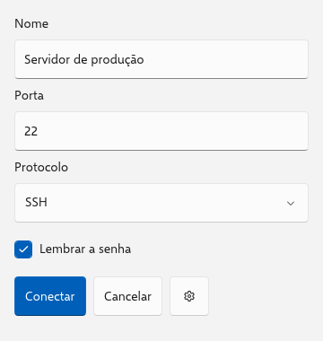
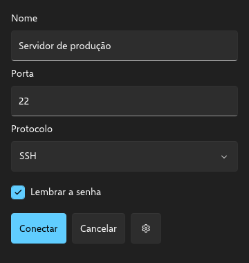
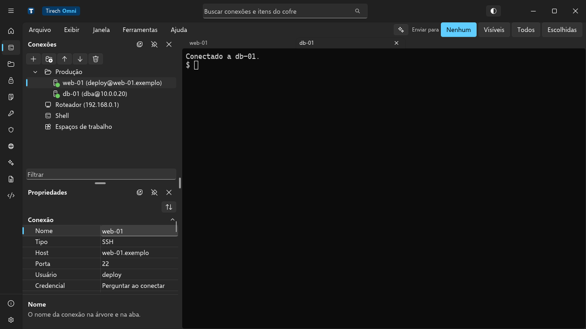

# Tomni UI

**Português** · [English](../en/README.md)

Biblioteca de interface em Rust com o visual Fluent do Windows 11, desenhada pela própria lib
e idêntica no Windows, no Linux, no macOS e no Android. O estado é reativo (signals), e a tela
de verdade pode ser vista, inspecionada, testada e conferida sem abrir janela: as mesmas
ferramentas servem para pessoas e para agentes de IA.

<p align="center">
  
  
</p>

## O que tem

- **Widgets do WinUI 3**, com as cores, medidas e o comportamento dele: botões, campos, listas,
  `ComboBox`, `NavigationView`, `TabView`, `TreeView`, `DataGrid`, `PropertyGrid`, menus,
  diálogos, `InfoBar`, `TitleBar` com o fundo Mica, ícones Fluent e mais (um exemplo de cada em
  [`crates/tomni-ui/examples`](../../crates/tomni-ui/examples)).
- **Renderização própria** pelo `vello` na GPU e pelo `vello_cpu` no processador, texto pelo
  `parley` com a Selawik embutida, layout flex pelo `taffy`.
- **Reatividade fina**: `signal`, `memo` e `effect`, e só o que mudou é redesenhado.
- **Testes sem janela**: o `TestApp` clica, digita e confere pela id dos widgets, e os
  snapshots dão os mesmos pixels em x86_64 e ARM.
- **Ferramentas para agentes**: a CLI `tomni-ui` e o servidor MCP `tomni-ui-mcp` tiram
  capturas, mostram a árvore de widgets, interagem com a tela e rodam o lint de acessibilidade
  e de layout.
- **Terminal** VT100, VT220 e xterm, com as conexões de processo local, Telnet, SSH (salto,
  proxy, agente, X11 e túneis) e serial.
- **Arquivos** locais e remotos: SFTP, FTP e FTPS, S3 e compatíveis, e as demais nuvens pelo
  `rclone`, com fila de transferências.
- **Redes embutidas**: OpenVPN, WireGuard, Tailscale (e Headscale), Nebula e ZeroTier em Rust.
  Rodam sem placa virtual e sem administrador, e só o tráfego do app passa por elas, por uma
  ponte SOCKS5 local com credencial aleatória.
- **IA**: cliente de modelos nos dialetos compatível com OpenAI e Messages da Anthropic, com
  streaming cancelável.
- **WebView** no controle do sistema (WebView2, WKWebView ou WebKitGTK) e **Markdown** em
  widgets.

O [Tirech Omni](https://github.com/TirechCorp/tirech-omni), um gerenciador de conexões SSH, é o
app de verdade feito com a lib:

<p align="center">
  
</p>

## Começando

Os crates ainda não estão no crates.io. Use pelo Git:

```toml
[dependencies]
tomni-ui = { git = "https://github.com/TirechCorp/tomni-ui" }

[dev-dependencies]
tomni-ui-test = { git = "https://github.com/TirechCorp/tomni-ui" }
```

Uma tela é uma função que monta widgets:

```rust
use tomni_ui::prelude::*;

fn login() -> impl View {
    let email = signal(String::new());
    let senha = signal(String::new());
    Form::new("Login").child(
        Column::new()
            .gap(12)
            .padding(24)
            .child(Edit::bind(email).id("email").placeholder("E-mail"))
            .child(Edit::bind(senha).id("senha").placeholder("Senha").password())
            .child(
                Button::new("Entrar")
                    .id("entrar")
                    .accent()
                    .disabled(move || !email.get().contains('@') || senha.get().len() < 6),
            ),
    )
}

fn main() -> Result<(), tomni_ui::platform::Error> {
    tomni_ui::App::new(login).size(390, 844).run()
}
```

E é testada sem abrir janela:

```rust
use tomni_ui_test::TestApp;

let mut app = TestApp::new(login).size(390, 844);
app.type_into("email", "ana@x.com").type_into("senha", "123456");
assert!(app.enabled("entrar"));
// Só o que mudou foi redesenhado (o olho da senha aparece depois da digitação).
assert_eq!(app.repaints_since_last(), ["email", "senha", "senha-revelar", "entrar"]);
```

Para rodar os exemplos:

```sh
cargo run -p tomni-ui --example login
cargo run -p tomni-ui --example terminal --features terminal
cargo run -p tomni-ui --example webview --features webview
```

O tema segue o claro ou escuro do sistema, a menos que `.theme(...)` o fixe. Quando a GPU é um
driver em software (o WARP numa VM, o llvmpipe), a janela desenha pelo processador. No Android,
o `android_main` passa o `AndroidApp` com `.android(app)` (veja o exemplo `login`).

O guia completo da API, que o `tomni-ui init` também copia para o seu projeto, está em
[`crates/cli/templates/AGENTS.md`](../../crates/cli/templates/AGENTS.md). O mapa curto fica no
[`llms.txt`](../../llms.txt).

## Features da fachada

O crate `tomni-ui` liga o resto por features, para não pesar em quem não usa:

| Feature | O que liga |
| --- | --- |
| `tools` (padrão) | o modo de ferramentas (`TOMNI_UI_TOOLS=1`), que a CLI e o MCP usam |
| `terminal` | o widget `Terminal`, o emulador e o Telnet, com a Cascadia Mono embutida |
| `pty`, `ssh`, `serial` | as conexões de processo local, SSH (`russh`) e porta serial |
| `files`, `sftp`, `ftp`, `s3`, `rclone` | arquivos locais e remotos, com a fila de transferências |
| `ai` | o cliente de modelos de linguagem |
| `markdown` | o `MarkdownView` e o realce do `TextEditor` |
| `webview` | o `WebView` com o motor do sistema (no Linux, pede o `libwebkit2gtk-4.1-dev`) |
| `webview-widget` | só o widget, com o motor falso dos testes |
| `cjk` | a Noto Sans JP embutida, para chinês, japonês e coreano |
| `mono` | a Cascadia Mono embutida para o `TextEditor` |
| `mcp` | o enquadramento de um servidor MCP (JSON-RPC por linha) |

As redes embutidas são crates à parte (`tomni-ui-openvpn`, `tomni-ui-wireguard`,
`tomni-ui-tailscale`, `tomni-ui-nebula` e `tomni-ui-zerotier`). Cada uma tem um builder e um
`proxy()`, o SOCKS5 que se passa ao `Ssh`, ao `Telnet` ou ao `Sftp`.

## Crates

| Crate | Papel |
| --- | --- |
| `tomni-ui` | a fachada que o app usa: `App`, `Ui`, árvore, lint e modo de ferramentas |
| `tomni-ui-core` | widgets, árvore com ids estáveis, camadas, foco e eventos |
| `tomni-ui-reactive` | `signal`, `memo` e `effect` (sobre o `reactive_graph`) |
| `tomni-ui-layout` | layout flex pelo `taffy` |
| `tomni-ui-text` | texto pelo `parley`, com as fontes embutidas |
| `tomni-ui-render` | o `Canvas`, com os backends CPU e GPU |
| `tomni-ui-theme` | o `FluentDrawer`, os ícones Fluent e os tokens de cor do WinUI 3 |
| `tomni-ui-platform` | janela `winit`, entrada, IME, seletor de arquivos e bandeja do sistema |
| `tomni-ui-terminal` | o `Terminal` e as conexões `Process`, `Telnet`, `Ssh` e `Serial` |
| `tomni-ui-files` | o `Fs` (local, SFTP, FTP, S3, rclone) e a fila de transferências |
| `tomni-ui-net` | proxy SOCKS5 e HTTP CONNECT, conexão TCP e o cliente HTTP |
| `tomni-ui-netstack` | a pilha TCP/IP em software (`smoltcp`) e a ponte SOCKS5 das VPNs |
| `tomni-ui-openvpn` | o cliente OpenVPN (TLS 1.2 e 1.3, `tls-auth`, `tls-crypt`, AES-GCM e ChaCha20) |
| `tomni-ui-wireguard` | o WireGuard (lê o `.conf` do `wg-quick`) |
| `tomni-ui-tailscale` | o nó do Tailscale e do Headscale, com DERP e MagicDNS |
| `tomni-ui-nebula` | a rede Nebula (certificados v1 e v2, lighthouse e punch) |
| `tomni-ui-zerotier` | o nó do ZeroTier (VL1 e VL2) |
| `tomni-ui-ai` | o cliente de modelos de linguagem |
| `tomni-ui-markdown` | o Markdown em widgets e a edição de Markdown |
| `tomni-ui-webview` | o `WebView` |
| `tomni-ui-win32` | as chamadas Win32 sem API segura (o único crate com `unsafe`) |
| `tomni-ui-test` | o `TestApp` e os snapshots |
| `tomni-ui-cli` | a CLI `tomni-ui` |
| `tomni-ui-mcp` | o servidor MCP `tomni-ui-mcp` |

## Ferramentas para agentes

A CLI e o servidor MCP compilam o app com o `cargo` e o rodam em modo de ferramentas: sem
janela, com a tela de verdade, os signals e os handlers do app, desenhada pelo backend CPU
determinístico.

```sh
cargo install --path crates/cli   # tomni-ui
cargo install --path crates/mcp   # tomni-ui-mcp

tomni-ui screenshot -p tomni-ui --example login --size 390x844 --theme dark
tomni-ui tree -p tomni-ui --example layout --view linha
tomni-ui lint -p tomni-ui --example form
tomni-ui build --target linux -p tomni-ui --example login
```

| CLI | MCP | O que faz |
| --- | --- | --- |
| `screenshot` | `ui_screenshot` | PNG da tela, com tamanho e tema |
| `tree` | `ui_tree` | os widgets, com id, tipo, retângulo e estado |
| — | `ui_interact` | ações pela id (clicar, digitar, teclas, rolar, escolher), com a captura e a árvore de volta |
| `lint` | `ui_lint` | contraste AA, alvo de toque de 44 px, texto cortado, fora da janela, caractere sem glifo e widget sem id |
| `run` | — | abre a janela |
| `build --target windows\|linux\|macos\|android` | — | o binário de release (o APK no Android) e o `THIRD-PARTY-NOTICES.txt` |
| `init` | — | grava no app o `AGENTS.md`, o `CLAUDE.md`, a skill do Claude Code e o `.mcp.json` |

No MCP, a sessão continua entre chamadas (o texto digitado e os cliques ficam) até o app ser
recompilado, a tela mudar ou vir `reset: true`. Erros de compilação voltam como erro da
ferramenta. `TestApp::assert_lint()` faz a mesma conferência do lint dentro dos testes.

## Snapshots

`assert_snapshot!("nome", pixmap)` compara a imagem com `snapshots/nome.png` na pasta do crate
testado. Sem referência, ou com diferença acima de 0,5% dos pixels, o teste falha e grava
`nome.snap.new.png` e `nome.snap.diff.png` (as diferenças em vermelho). Depois de conferir a
imagem nova, aprove com:

```sh
TOMNI_UI_UPDATE_SNAPSHOTS=1 cargo test
```

Os snapshots usam o `CpuCanvas::deterministic`: sem SIMD, uma thread e pipeline `f32`, para
x86_64 e ARM darem os mesmos pixels. Para conferir a GPU contra as referências da CPU:

```sh
TOMNI_UI_BACKEND=gpu cargo test -p tomni-ui-test --features gpu,cjk
```

## Compilar e testar

A versão do Rust está fixada em `rust-toolchain.toml` (pede o `rustup`); a mínima suportada é
a 1.89.

```sh
cargo build
cargo test --workspace
cargo test -p tomni-ui-test --features cjk
```

Os testes contra servidores reais (FTP, S3, rclone, OpenVPN, WireGuard, Tailscale, Nebula e
ZeroTier) são opcionais e sobem os servidores no Docker: veja o
[`CONTRIBUTING.md`](CONTRIBUTING.md).

## Contribuir

Leia o [`CONTRIBUTING.md`](CONTRIBUTING.md) (a bateria do CI, a estrutura e as regras) e o
[código de conduta](CODE_OF_CONDUCT.md). Falhas de segurança vão pelo caminho do
[`SECURITY.md`](SECURITY.md), não por issue pública. O que está planejado fica em [`ROADMAP.md`](ROADMAP.md).

## Licença

MIT ou Apache-2.0, à sua escolha ([`LICENSE-MIT`](../../LICENSE-MIT),
[`LICENSE-APACHE`](../../LICENSE-APACHE)).

- As fontes embutidas (a Selawik em `tomni-ui-text`, a Noto Sans JP da feature `cjk` e a
  Cascadia Mono da feature `mono`) são OFL-1.1.
- Os tokens de cor vêm do `microsoft/microsoft-ui-xaml` (MIT).
- O WireGuard, o Tailscale e o Nebula têm partes portadas do código original; as referências e
  as licenças estão no `NOTICE` de cada crate. O OpenVPN foi escrito a partir da descrição
  pública do protocolo, e o ZeroTier, conferido contra pacotes reais, sem copiar código.

As dependências ficam restritas a licenças permissivas, conferidas por
`cargo deny check licenses`. MIT, BSD, ISC, Zlib, Unicode-3.0 e OFL pedem que o aviso de
copyright acompanhe o binário, e isso vale também para os apps feitos com a lib. O
`tomni-ui build` gera o `THIRD-PARTY-NOTICES.txt` junto do binário, ou gere à mão:

```sh
cargo install --locked cargo-deny
cargo install --locked cargo-about --features cli
cargo about generate about.hbs -o target/THIRD-PARTY-NOTICES.txt
```
